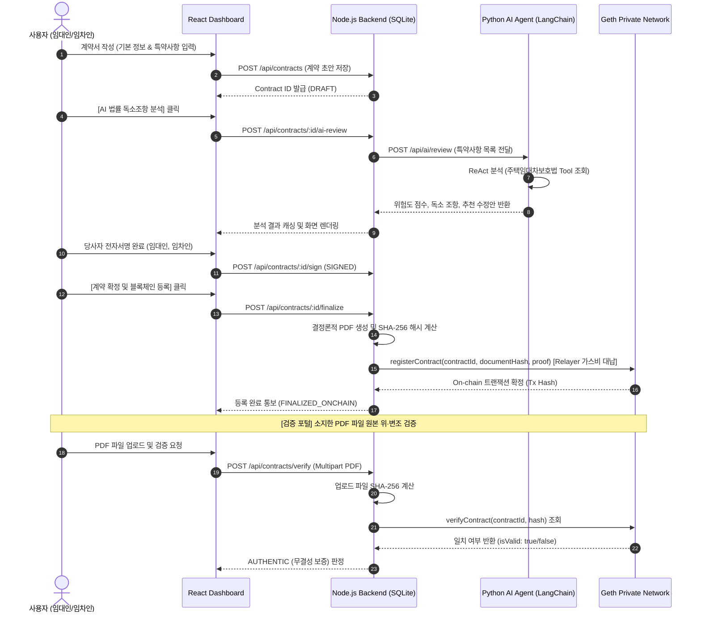

# 🏢 Hybrid Real Estate Contract SaaS (부동산 하이브리드 전자계약 플랫폼)

> **개인정보 보호를 위한 Split Hybrid Storage** + **LangChain 기반 AI 특약 법률 리스크 검토** + **Geth 블록체인 기반 원본 무결성 검증**

본 프로젝트는 부동산 계약(매매, 전세, 월세) 시 발생하는 **전세사기 위험, 불공정 독소 조항, 계약서 위·변조 문제**를 해결하기 위해 설계된 풀스택 Web3 & AI 하이브리드 전자계약 SaaS MVP입니다.

---

## 🌟 핵심 아키텍처 및 설계 원칙

### 1. Split Hybrid Storage (개인정보 보호 및 온체인 무결성 보장)
- **Off-Chain DB (SQLite):** 개인식별정보(PII: 이름, 주민번호, 전화번호), 상세 주소, 계약 조항 전문, 생성된 계약서 PDF 원본을 안전하게 격리 보관합니다.
- **On-Chain (Geth Private Network):** 블록체인에는 어떠한 개인정보나 평문도 저장하지 않으며, 오직 위·변조 검증용 `contractId`, `SHA-256 documentHash`, `signatureProof`, `timestamp`만 최소 크기(`bytes32`)로 기록합니다.

### 2. Web3 Relayer Pattern (사용자 지갑 불필요)
- 일반 웹 SaaS 사용자는 메타마스크나 코인/가스비 지불 없이 전자서명만으로 계약을 체결합니다.
- Node.js 백엔드가 서버 관리형 Relayer 계정으로 가스비를 대납하며 온체인 트랜잭션을 일괄 처리합니다.

### 3. ReAct AI Agent (법률 리스크 및 독소 조항 탐지)
- `LangChain`과 `create_react_agent`를 활용하여 로컬 LLM(Ollama `gemma4:e2b`)과 연동됩니다.
- 주택임대차보호법 및 표준 판례 도구(`tools.py`)를 통해 대항력, 우선변제권, 보일러 수선의무 전가, 대출 미승인 시 계약금 몰수 등 불공정 독소 조항을 실시간 탐지하고 수정안을 제시합니다.

---

## 📁 프로젝트 모노레포 구조

```text
blockchain_with_agent/
├── .env.example                                      # 루트 통합 환경변수 템플릿
├── .gitignore                                        # 비밀키, PII DB, Geth 원장 데이터 차단
├── GEMINI.md                                         # 프로젝트 마스터 코딩 규칙
├── README.md                                         # 프로젝트 종합 설명서 (본 문서)
│
├── blockchain/                                       # [Phase 1] 블록체인 인프라 & 스마트 컨트랙트
│   ├── contracts/RealEstateContractRegistry.sol      # 위·변조 검증 Solidity 컨트랙트 (^0.8.20)
│   ├── scripts/deploy.js                             # 순수 JS 컨트랙트 배포기 (ethers v6)
│   ├── scripts/start-geth-dev.bat                    # Geth --dev 로컬 개발망 실행 스크립트
│   ├── test/RealEstateContractRegistry.test.js       # 온체인 등록/검증 단위 테스트
│   └── hardhat.config.js                             # Hardhat 설정 (100% Pure JS ESM)
│
├── backend/                                          # [Phase 2] Node.js 코어 백엔드 & Web3 Gateway
│   ├── src/server.js                                 # Express 서버 진입점
│   ├── src/db.js                                     # SQLite3 오프체인 스토리지 (WAL 모드)
│   ├── src/web3.js                                   # Web3 Relayer 모듈 (Geth 온체인 기록 및 검증)
│   ├── src/pdf.js                                    # 결정론적 PDF 생성 및 SHA-256 해시 엔진
│   ├── src/routes/contracts.js                       # 계약서 CRUD, AI 검토 위임, 온체인 등록 API
│   ├── scripts/fund-relayer.js                       # Geth 코인베이스 -> Relayer 100 ETH 자동 펀딩
│   └── test/flow.test.js                             # 전체 계약 생성-서명-온체인등록-검증 E2E 테스트
│
├── ai-agent/                                         # [Phase 3] Python LangChain AI 법률 검토기
│   ├── pyproject.toml                                # uv 패키지 매니저 설정
│   ├── test_ai.py                                    # 독소 조항 분석 테스트 스크립트
│   └── src/
│       ├── config.py                                 # Ollama 및 환경변수 설정
│       ├── schemas.py                                # Pydantic v2 구조화 출력 모델
│       ├── tools.py                                  # 주택임대차보호법 판례 검색 Tool
│       ├── agent.py                                  # LangChain create_react_agent ReAct 엔진
│       └── main.py                                   # FastAPI REST 서버
│
└── client/                                           # [Phase 4] React + Vite 경량 웹 대시보드
    ├── index.html                                    # 진입 HTML
    ├── vite.config.js                                # 백엔드 프록시 설정
    └── src/
        ├── App.jsx                                   # 계약 작성, AI 분석, 서명, PDF 무결성 검증 뷰
        └── index.css                                 # Pretendard 기반 모던 SaaS 스타일
```

---

## 🛠️ 기술 스택 (Tech Stack)

| 계층 | 기술 스택 | 설명 |
| :--- | :--- | :--- |
| **Blockchain** | Solidity `^0.8.20`, Go-Ethereum (Geth), Hardhat, Ethers.js v6 | `RealEstateContractRegistry` 컨트랙트, PoA Dev 망 |
| **Backend** | Node.js (Pure JS, ESM), Express, SQLite3, PDFKit | PII 격리 저장, 결정론적 해싱, Web3 Relayer 가스 대납 |
| **AI Agent** | Python 3.14+, `uv`, FastAPI, LangChain, LangGraph, Ollama (`gemma4:e2b`) | ReAct 에이전트, 주택임대차보호법 Tool, Pydantic 검증 |
| **Frontend** | React 18, Vite, Lucide-React, Pure CSS | 일반 웹 기반 계약서 작성기 & PDF 원클릭 위변조 검증기 |

---

## 🚀 빠른 시작 가이드 (Getting Started)

### 0. 사전 준비 사항
- **Node.js** (v18 이상)
- **Geth (Go-Ethereum)**: `geth` 명령어가 PATH에 등록되어 있어야 함
- **Ollama**: 로컬 실행 중이어야 하며 `ollama run gemma4:e2b` 설치 완료 상태
- **Python uv**: `uv` 설치 완료 상태

---

### 1. 환경변수 설정
루트 디렉터리의 `.env.example`을 복사하여 `.env`를 생성합니다:
```bash
cp .env.example .env
```

---

### 2. 전체 서비스 실행 (4개의 터미널 창)

#### 터미널 1: Geth 프라이빗 개발망 실행
```cmd
cd blockchain
npm run geth:dev
```
*(최초 1회 컨트랙트 배포 및 펀딩 필요 시)*
```cmd
cd blockchain
npm run deploy:local

cd ../backend
node scripts/fund-relayer.js
```

#### 터미널 2: Python AI 법률 에이전트 실행
```cmd
cd ai-agent
uv run uvicorn src.main:app --host 127.0.0.1 --port 8000 --reload
```

#### 터미널 3: Node.js 백엔드 서버 실행
```cmd
cd backend
npm run dev
```
*(포트: `http://127.0.0.1:4000`)*

#### 터미널 4: React 웹 대시보드 실행
```cmd
cd client
npm run dev
```
*(접속 주소: **`http://localhost:3000`**)*

---

## 🔄 핵심 비즈니스 워크플로우



---

## 🔒 보안 및 개인정보 보호 (Compliance)
1. **PII 완전 격리:** 주민등록번호, 연락처, 상세 주소 등은 어떠한 경우에도 블록체인 노드에 전파되지 않습니다.
2. **결정론적 해시 무결성:** 공백 하나, 글자 하나의 위·변조가 발생하더라도 완전히 다른 SHA-256 다이제스트가 생성되어 검증 포털에서 즉시 위변조가 감지됩니다.
3. **무결성 감사 로그:** 온체인 등록 시점의 블록 타임스탬프와 Relayer 서명 주소가 영구 보존되어 사후 분쟁 시 법적 증거력을 제공합니다.

